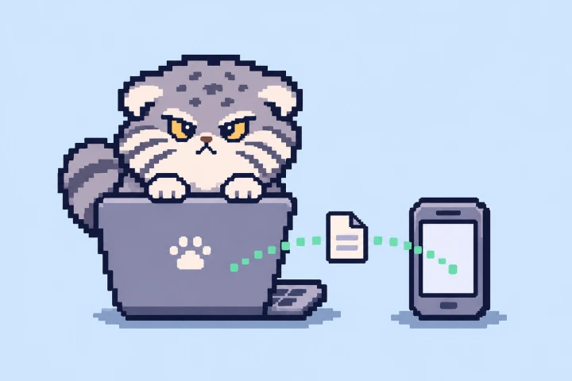

<p align="center">
  
</p>

<h1 align="center">Pallas Agent</h1>

<p align="center">
  <b>A whole AI agent, inside your iPhone.</b><br>
  <a href="https://testflight.apple.com/join/73Pbt1su">Get it on TestFlight</a> · <a href="README.zh-CN.md">简体中文</a>
</p>

**A real Linux machine runs inside an iPhone app.** bash, Node.js, Python and npm, with no jailbreak and no JIT, installed straight from TestFlight. It can also operate other apps on your phone, and hand tasks to your computer and bring the results back.

Pallas Agent is a native Swift/SwiftUI app built on [DeepSeek Harness](https://github.com/deepseek-ai/deepseek-harness). Model inference requires an internet connection: sign in with ChatGPT, use a DeepSeek account, or add any OpenAI-compatible endpoint.

**0.5.1** · 2026-11-18 · iOS 18+

<p align="center">
  <a href="assets/pallas-demo-en.mp4"></a><br>
  <a href="assets/pallas-demo-en.mp4">▶ Watch the full video (42 s, with sound)</a>
</p>

## One message, three jobs

In the video, a single message is sent and Pallas Agent finishes three jobs on its own:

1. **Reads a poster, creates the event**: it reads the date and place from an event poster, creates the event in the system Calendar with a one-hour alert, then goes back to check it.
2. **Runs Python on the phone**: it cleans a 29-row signup list, removes duplicates, flags a missing email, and produces a clean CSV and a signup report.
3. **Continues on the Mac**: it finds the latest installer package on the computer, builds an event brief web page, and sends it back to the phone.

All over 5G, with no cable attached. About 6.5 minutes and 41 steps, and all three files end up on the phone.

## Just say it

> "Create a note in Notes titled Friday list, with 'pick up the parcel at 3 pm' as the body."

The phone opens Notes, taps and types, then checks the screen again to confirm.

> "Use ffmpeg on my Mac to convert this video to MP4."

The video goes from the phone to the computer, gets converted there, and comes back.

## Installation and beta access

| Option | Includes | Requires |
| --- | --- | --- |
| [TestFlight public beta](https://testflight.apple.com/join/73Pbt1su) | Chat, on-device Linux sandbox, plugins and skills, computer connection | An iPhone or iPad on iOS 18+ |
| Sideload package (in testing) | All of the above + the phone-control runner | A Mac, a free Apple Account, Developer Mode |

## What you can do

### Run Linux on your phone

Switch to **This iPhone** and the engine runs on the iPhone itself. The first time the model calls bash, the app boots an arm64 Linux virtual machine inside its own process and mounts the workspace into it. After that, it resumes from a saved machine state and is ready to run commands in **about 1.6 seconds**.


- **A real shell**: bash, Node.js, npm, Python 3.12, curl, git and ripgrep out of the box. Run scripts and read or write Excel, Word and PowerPoint files.
- **Files stay on the phone**: the workspace, attachments and generated files live inside the app. Folders you authorize, including all of iCloud Drive, can be read, written and searched by the model.
- **Plugins and skills that travel with your computer**: install DSH plugins from npm or import a plugin folder from desktop DSH; plugins installed on the phone can be packed and shared back to a computer. Install skills from a GitHub link or a ZIP, tgz or `.skill` package, ready to use immediately.
- **Local network devices**: the model can find and reach printers, NAS boxes, smart-home hubs, web admin pages and SSH servers on the same network, and can publish services started in Linux to the LAN.
- **Any model you like**: sign in with ChatGPT or a DeepSeek account, or add any OpenAI-compatible endpoint, then switch from the composer at any time.

### Control apps on your phone

The phone looks at its own screen, taps, swipes and types, **with no computer nearby**: unplugged, Wi-Fi off, cellular only (verified on an iPhone 17 Pro running iOS 27).


- **It sees the screen**: models that accept images get real screenshots; text-only models get on-device OCR text with positions.
- **Checks before acting**: a fresh screenshot is compared before every touch; if the screen changed, the model has to look again.
- **Multi-step navigation**: the model can submit a whole plan at once, and the runner executes and verifies each step.
- **Key steps ask first**: opening an app, sending, deleting and paying wait for your consent; while another app is in front, you answer with Allow / Don't Allow on a notification. Or switch to fully automatic.
- **Take over any time**: switching back to Pallas Agent or locking the phone revokes control for the round.

Phone control is off by default and needs the companion runner plus Developer Mode. No jailbreak is required.

### Run tasks on your computer

The phone can switch to a computer running DeepSeek Harness at any time, or hand a single task to it straight from a phone chat.



- **Automatic discovery**: computers with the pairing plugin announce themselves on the LAN and show up under **Remote Host**; tap one to pair by QR code. A paired computer is found again even after its IP address changes.
- **QR code or SSH**: the pairing code carries all of the computer's addresses (LAN, Tailscale and so on) and the phone picks one that works. SSH is supported too, including a built-in terminal.
- **Hand work to the computer from a phone chat**: the model sends the task and files to the computer and runs it once you allow it; a live panel shows each step and the computer's screen, and the output comes back to the phone.
- **Operate desktop apps**: once the computer has a desktop control tool such as [open-computer-use](https://github.com/iFurySt/open-computer-use), one sentence from the phone is enough for it to read windows, click buttons and type.

**Connect to a Harness on your computer**: configure a model on the computer and run `dsh web --no-open`. In the app, under **Remote Host**, enter the computer's LAN or public address and the token from the launch link (on a real device, `127.0.0.1` points to the phone itself).

## Security

- **Commands stay in the VM**: bash runs inside the Linux virtual machine and can only reach the mounted workspace; root inside the VM has most of its capabilities removed and cannot modify the system disk.
- **Phone control is a separate tool**: it lives outside the Linux sandbox, is off by default, and while off the model cannot see it at all.
- **Key actions need your OK**: sending, deleting and paying on the phone, and tasks and actions on the computer, all ask first.
- **Keys stay on the phone**: API keys are stored in the system Keychain and used only to authenticate with their own service.

## More features

- **AI phone calls**: "Call the restaurant and book a table for two on Friday." Pallas dials from your Twilio cloud number and a voice AI handles the call, with live captions; listen in, take over or hang up at any time. It confirms who it is calling before dialing and asks you when the other side needs your decision.
- **Your devices, connected**: iPhone, iPad and computer pair with each other to pass files and tasks back and forth.
- **Memory**: remembers things about you plus its own notes; view and edit them, let it tidy them up daily, and restore the previous version if needed.
- **Search past conversations**: the model can full-text search your history to answer "that thing we talked about last time…".
- **Keeps replying in the background**: leave mid-reply and a system banner shows progress; you get a notification when it's done.
- **Chat**: streaming output, expandable reasoning, context usage, `/compact`, `/model`, sub-agent transcripts and a built-in browser.
- **Sessions**: search, pin, folders, archive and status filters; on Apple Intelligence devices, conversation titles come from the on-device Apple model.
- **Sharing and replay**: export as text, image, Markdown or offline HTML, or create an encrypted share link; replays can be scrubbed and sped up, and "Continue chat" carries a conversation into a new session.
- **Personalization**: color themes, home screen icons, chat wallpapers, launch screens and text size; split layouts on iPad and foldables.

<details>
<summary><b>Under the hood: how Linux runs inside an iPhone app</b></summary>

- **No JIT**: the VM uses QEMU's interpreting backend and runs inside the app's own process, which is why it can ship through TestFlight.
- **Snapshot resume**: after the first boot the machine is saved as a snapshot, and later starts are ready to run commands in about 1.6 s.

</details>

## Pallas Core: build it yourself

This repository holds the source of **Pallas Core**, the open part of Pallas Agent, under the Apache License 2.0. Core is a complete app: chat with streaming and reasoning, the on-device engine (without the Linux machine, so without bash), remote hosts over `dsh web` and SSH, your own API keys and any OpenAI-compatible endpoint, ChatGPT and DeepSeek sign-in, plugins and skills, memory, scheduled tasks, calendar, reminders, contacts and mail connectors, handing tasks to a paired computer, sharing and replay, widgets and Shortcuts.

The TestFlight app adds what Core leaves out: the Linux machine (bash, Python, npm), phone control, AI phone calls, activity review, device-to-device link, embedded Tailscale and Claude subscription sign-in.

| | Pallas Core (this source) | Pallas Agent (TestFlight) |
| --- | --- | --- |
| Chat, models, plugins, skills, memory | ✓ | ✓ |
| On-device engine | ✓ | ✓ |
| Remote hosts, hand tasks to a computer | ✓ | ✓ |
| Linux machine (bash, Python, npm) | | ✓ |
| Phone control, AI phone calls, activity review | | ✓ |
| Device-to-device link, embedded Tailscale | | ✓ |

**Requirements:** a Mac with Xcode 27, [XcodeGen](https://github.com/yonaskolb/XcodeGen), and for the on-device engine also Node.js, npm and Rust (`rustup target add aarch64-apple-ios`).

```sh
xcodegen generate
# The on-device engine (optional: without it the app works with remote hosts only)
python3 Embedded/build.py
open PallasCore.xcodeproj
```

Set `PALLAS_CORE_BUNDLE_ID` and `DEVELOPMENT_TEAM` in `project.yml` to your own before running on a device. The iOS Simulator has no on-device engine.

This source is exported from the app's single codebase on every release, so issues and pull requests are welcome here.

## Feedback

Questions and suggestions are welcome in [Issues](../../issues).

## Copyright and license

Copyright © 2026 deemo0666.

The source code in this repository is licensed under the [Apache License 2.0](LICENSE). The names "Pallas", "Pallas Agent" and "Pallas Core", the app icons and logo, the Pallas cat artwork, and the videos and images in `assets/` are not licensed under it; see [NOTICE](NOTICE). You may use them only to refer or link to this project. Builds you distribute need a name and icon of their own.

Third-party components keep their own licenses: see `App/ThirdPartyLicenses.txt`, and in the app **Settings › About**. The source code for the QEMU and Linux guest in the TestFlight app is published in [Pallas VM](https://github.com/deemo0666/pallas-vm).

Pallas Agent is an independent project and is not affiliated with DeepSeek.
