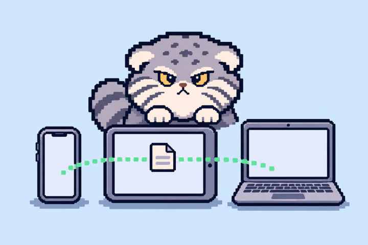
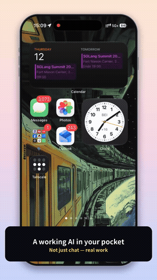

<h1 align="center">Pallas Agent</h1>

<p align="center">
  <b>An AI assistant that gets things done on iOS and Mac</b><br>
  <a href="https://testflight.apple.com/join/73Pbt1su">Join the TestFlight beta</a> · <a href="README.zh-CN.md">简体中文</a>
</p>

Give Pallas a task in chat. It can call a restaurant to book a table, turn an event poster into a calendar entry, operate another app, or clean up a spreadsheet with Python on your phone. Pair multiple iPhones, iPads and Macs, then name the device for each job in the same on-device chat. Replies and files come back to the device that sent the task.

Pallas Agent is a native Swift and SwiftUI app with a mobile-adapted [DeepSeek Harness](https://github.com/deepseek-ai/deepseek-harness) engine built in. The engine and local tasks run on the device. Model inference uses the online service you choose.

**0.5.1** · 2026-11-18 · iOS 18+

<p align="center">
  
</p>

## Getting started

Install the app from TestFlight, then sign in with ChatGPT or DeepSeek, or add an OpenAI-compatible endpoint. Start a chat under **This iPhone** and switch models from the composer. [AI phone calls](#ai-phone-calls) use a separately configured cloud number and API key. For phone control, [install the companion runner with the DSH plugin](#install-phone-control-with-the-dsh-plugin).

## What you can do

### AI phone calls

> “Call this restaurant and book a table for two on Friday night.”


Pallas places a real call from your Twilio number, and a voice AI speaks on your behalf. By default it shows you the recipient, number and purpose before dialing. Follow live captions, listen in, take over with your iPhone’s microphone, hand the call back or hang up. Pallas asks in the app when it needs a decision from you. After the call, you can review the transcript and outcome.

Set up a Twilio number for outgoing calls and an OpenAI API key in **Settings → Capabilities → AI Phone Calls**, then tell Pallas what the call should accomplish in an on-device chat.

### Work across multiple iPhones, iPads and Macs

> “Have my iPad in the study clean up this signup sheet, then use my Mac to convert this video to MP4. Send both results back here.”



- To pair **iPhones and iPads**, open **My Devices** in Pallas. Tap **Show This Device’s Code** on one device and **Scan to Connect** on the other. Paired devices can send files directly to one another. When you hand off a task, the receiving device runs it in a new chat. Keep Pallas open with the on-device engine enabled on that device.
- To add a **Mac**, run `dsh web` with the Pallas pairing plugin. Generate a QR code on the plugin page and scan it from **My Devices** on your iPhone or iPad. Hand the Mac a task and its attachments, and follow its progress on the device that sent it. [Pallas iPhone DSH Plugin](https://github.com/deemo0666/pallas-iphone-dsh-plugin)

**My Devices** discovers devices on the same local network. To connect across networks, join the paired devices to the same Tailscale network.

### Calendar, reminders and scheduled tasks

With permission, Pallas can look up calendar events and contacts, create events and reminders, prepare text or email drafts, and run your existing Shortcuts.

Schedule recurring work. iOS can notify you when it’s due or run the task in the background when the system allows. Work that needs the screen waits for you to open Pallas. You can view past runs and edit the notes Pallas follows next time.

### Control other apps

> “Create a note in Notes called Friday list and write ‘pick up the parcel at 3 pm.’”


Pallas reads the screen, taps, swipes and types on the device, then checks the result. Models that accept images can see screenshots. Text models can read text and positions recognized on the device. The runner can check each step of a multi-step plan and have the model look again when the screen changes.

By default, Pallas asks before key actions such as opening an app, sending, deleting or paying. Switch back to Pallas or lock the phone to stop control. After setup, phone control works unplugged. Cellular-only operation was verified on an iPhone 17 Pro running iOS 27.

#### Install phone control with the DSH plugin

Use a Mac with macOS 13 or later and DSH Web set up, plus a USB cable. First install a Pallas Agent `0.5.1` build that includes **Allow Computer Control** on the iPhone. If you sideloaded the main app under the same Apple Account, use build `0.5.1 (18)` with the original installer's shared entitlements. [Version requirements and setup](https://github.com/deemo0666/pallas-iphone-dsh-plugin#install-into-dsh)

1. Download the plugin ZIP on your Mac. In Terminal, change to the folder containing it, then unpack, verify and install the plugin into the DSH Web profile. [Download the macOS plugin v0.3.3](https://github.com/deemo0666/pallas-iphone-dsh-plugin/releases/download/v0.3.3/dsh-local-pair-0.3.3-macos.zip)

   ```sh
   unzip dsh-local-pair-0.3.3-macos.zip -d pallas-dsh-0.3.3 &&
     cd pallas-dsh-0.3.3 &&
     shasum -a 256 -c SHA256SUMS &&
     dsh plugin --profile web add ./dsh-local-pair-0.3.3-macos.tgz
   ```

2. Start or restart `dsh web` and open the link it prints in your Mac browser. Connect and unlock the iPhone over USB. Tap **Trust** on the iPhone if prompted.
3. In the DSH Web sidebar, open **Pallas iPhone Control → Install and repair**. Select the iPhone and click **Install phone control**. Follow the installer prompts to sign in with your Apple Account, enter the verification code, and turn on and confirm Developer Mode on the iPhone.
4. Once DSH shows **Phone control installed**, open Pallas Agent on your iPhone. Under **Settings → Capabilities → Phone Control**, turn it on and tap **Try Phone Control** to verify the installation with Calculator.

When the signature expires, reconnect the iPhone to the Mac and click **Install phone control** again. **Repair control runtime** prepares the developer environment for a Runner that's already installed. [The plugin's USB installation guide](https://github.com/deemo0666/pallas-iphone-dsh-plugin#install-the-runner-on-the-iphone)

### Run code and work with files on the phone


The first time the local engine calls bash, Pallas starts an arm64 Linux virtual machine and mounts the workspace. QEMU interprets the guest’s instructions, and later runs can resume from a snapshot. The VM includes bash, Python, Node.js, npm, curl, git and ripgrep for running scripts, cleaning up Excel spreadsheets and generating documents.

The workspace, attachments and output live in the app. You can grant Pallas access to read, write and search other folders. Install DSH plugins from npm or import them from a computer. Skills can be imported from a GitHub link or a local package.

### Connect to a remote DSH host

Switch to a computer running `dsh web` from **My Devices** to run the conversation and its tools on that host. To connect by address, enter a DSH Web address reachable from your phone and the token from the launch link under **My Devices → Advanced → Connect with Host Address**. You can also open a remote terminal over SSH.

With a desktop control tool installed on the host, you can operate desktop apps from a remote chat. [open-computer-use](https://github.com/iFurySt/open-computer-use)

## One message, three jobs

<p align="center">
  <a href="assets/pallas-demo-en.mp4"></a><br>
  <a href="assets/pallas-demo-en.mp4">▶ Watch the full video (42 seconds, with sound)</a>
</p>

1. Pallas reads the time and place from an event poster, creates it in Calendar and sets a one-hour alert.
2. It runs Python on the phone to clean 29 signup rows, remove duplicates, flag missing email and produce a CSV and signup report.
3. On the paired Mac, it finds the latest installer package, builds an event brief as a web page and sends it back.

The demo ran over 5G. The job took about six and a half minutes, and all three outputs came back to the phone.

## More features

- **Memory and history search** help you pick up where you left off. You can view, edit and restore the memories Pallas saves.
- **Chat** supports streaming, expandable reasoning and tool details, sub-agent transcripts, and a built-in browser. Pin, file or archive conversations, and use the split layout on iPad. API keys are stored in the system Keychain.
- **Siri, Shortcuts and widgets** can open chats or start tasks. Press-to-talk and continued replies in the background are available from iOS 26.
- **Sharing and replay** support export as text, an image, Markdown or offline HTML, encrypted share links, and continuing a replay in a new chat.
- **Activity Review** is in testing in development builds. It captures screen text while you record so Pallas can review what you did and where you got stuck in a new chat.

## Related repositories

- Corresponding source for the Linux VM in the TestFlight build, including the Linux kernel, QEMU patches and guest components. [Pallas VM](https://github.com/deemo0666/pallas-vm)
- The upstream project for Pallas's built-in engine, the `dsh` command and the DSH Web host. [DeepSeek Harness (DSH)](https://github.com/deepseek-ai/deepseek-harness)
- Computer pairing, iPhone control and USB setup in DSH Web. [Pallas iPhone DSH Plugin](https://github.com/deemo0666/pallas-iphone-dsh-plugin)
- The companion runner for screen reading, taps and typing on iPhone, with a macOS installer kit. [Pallas iPhone Runner](https://github.com/deemo0666/pallas-iphone-runner)

## Feedback

Questions and suggestions are welcome in [Issues](../../issues).

## Copyright and license

Copyright © 2026 deemo0666.

The source code in this repository is licensed under the [Apache License 2.0](LICENSE). You may use the project names, app icons and logo, Pallas cat artwork, and videos and images in `assets/` only to refer to or link to this project. Use your own name and icon for builds you distribute. See [NOTICE](NOTICE) for the full terms.

Third-party components keep their own licenses. See `App/ThirdPartyLicenses.txt` and **Settings › About** in the app.

Pallas Agent is an independent project and is not affiliated with DeepSeek.
