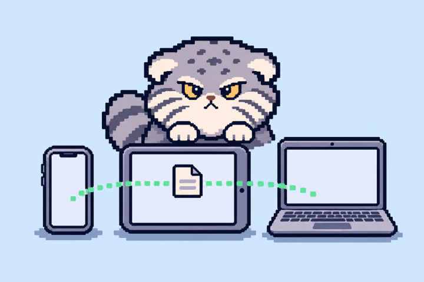
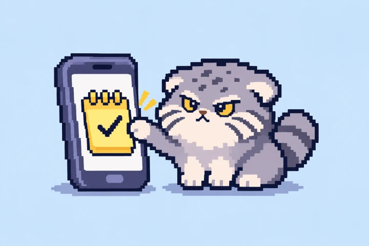
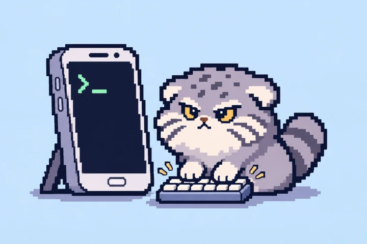
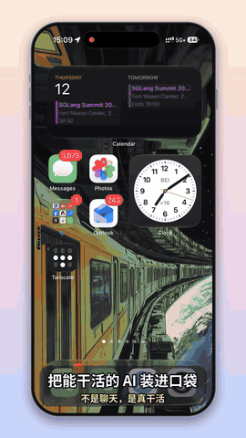

<h1 align="center">Pallas Agent</h1>

<p align="center">
  <b>在 iPhone 和 iPad 上替你办事的 AI 助手</b><br>
  <a href="https://testflight.apple.com/join/73Pbt1su">加入 TestFlight 测试</a> · <a href="README.md">English</a>
</p>

在对话里交代任务，Pallas 可以替你打电话订位、把海报里的活动加进系统日历、操作其他 App，或在手机上用 Python 清理表格。配对多台 iPhone、iPad 和 Mac 后，可以在同一个本机对话里按设备名分派工作，把答复和文件收回到发起任务的设备。

Pallas Agent 用 Swift 和 SwiftUI 原生开发，内置适配移动设备的 [DeepSeek Harness](https://github.com/deepseek-ai/deepseek-harness) 引擎。引擎和本机任务在设备上运行，模型推理由你选择的联网服务提供。

**0.5.1** · 2026-11-18 · iOS 18+

<p align="center">
  
</p>

## 开始使用

通过 TestFlight 安装主 App 后，登录 ChatGPT 或 DeepSeek，或添加 OpenAI 兼容接口。用「本机」开始对话，随时可以在输入框切换模型。[AI 打电话](#ai-打电话)需要单独配置云号码和 API Key。手机操控的配套执行器可以[用 DSH 插件安装](#用-dsh-插件安装手机操控)。

## 主要功能

### AI 打电话

> 「帮我打给这家餐厅，订周五晚上两个人的位子。」


Pallas 用你的 Twilio 云号码拨出真实的电话，由语音 AI 和对方沟通。默认在拨号前给你看打给谁、号码和要办的事。通话中有实时字幕，你可以旁听、用 iPhone 麦克风接管、交还给 AI 或挂断。遇到需要你决定的事，Pallas 会在 App 里问你。结束后可回看通话字幕和结果。

在「设置 → 能力 → AI 打电话」配置支持外呼的 Twilio 号码和 OpenAI API Key，然后在本机对话里交代电话要办的事。

### 多台 iPhone、iPad 和 Mac 一起工作

> 「让书房的 iPad 清理这份报名表，再用我的 Mac 把这段视频转成 MP4，结果都传回来。」



- 在**多台 iPhone 和 iPad** 上打开 Pallas。在一台设备的「我的设备」里点「显示本机二维码」，另一台点「扫码连接」。配对后可直接互传文件。交给另一台设备的任务会在那台设备的新对话里运行，接收端需要打开 Pallas 并开启本机引擎。
- 要加入 **Mac**，在 Mac 上运行装有 Pallas 配对插件的 `dsh web`，从插件页生成二维码，再到 iPhone 或 iPad 的「我的设备」扫码。Mac 可以接手任务和附件，你可以在发起任务的设备上查看执行进度。[Pallas iPhone DSH 插件](https://github.com/deemo0666/pallas-iphone-dsh-plugin)

「我的设备」会发现同一局域网里的设备。跨网络时，可以让已配对的设备加入同一个 Tailscale 网络。

### 日历、提醒事项和定时任务

授权后，Pallas 可以直接查日历和通讯录，创建活动和提醒事项，准备短信或邮件草稿，或者运行你已有的快捷指令。

可以把重复的工作设成定时任务。到点后系统可发通知，iOS 允许时在后台运行，需要操作屏幕的任务等你打开 Pallas 再做。你可以查看运行记录，并编辑任务的做法备注供下次执行参考。

### 操作手机上的 App

> 「在备忘录新建一条『周五清单』，写上『下午三点取快递』。」



Pallas 在设备上看屏幕、点按、滑动和输入，操作后再读屏核对。支持读图的模型可以看截屏，文字模型可以读设备上识别的文字和位置。执行器能逐步检查一段操作计划，检测到画面变化时请模型重新观察。

默认在打开 App、发送、删除或付款等关键步骤前请求确认。切回 Pallas 或锁屏即可停下操控。装好后可以拔线使用，已在 iPhone 17 Pro 的 iOS 27 上用蜂窝网络验证。

#### 用 DSH 插件安装手机操控

准备一台已配置 DSH Web 的 Mac（macOS 13 或以上）和一根 USB 数据线。iPhone 上先安装带「允许电脑操控」入口的 Pallas Agent `0.5.1`。如果主 App 是用同一 Apple 账号侧载的，请使用带原安装器共享权限的 `0.5.1 (18)`。[版本要求与安装说明](https://github.com/deemo0666/pallas-iphone-dsh-plugin/blob/main/README.zh-CN.md#安装到-dsh)

1. 在 Mac 下载插件 ZIP。在终端切到 ZIP 所在目录，解压、校验并安装到 DSH 的 Web 配置。[下载 macOS 插件 v0.3.3](https://github.com/deemo0666/pallas-iphone-dsh-plugin/releases/download/v0.3.3/dsh-local-pair-0.3.3-macos.zip)

   ```sh
   unzip dsh-local-pair-0.3.3-macos.zip -d pallas-dsh-0.3.3 &&
     cd pallas-dsh-0.3.3 &&
     shasum -a 256 -c SHA256SUMS &&
     dsh plugin --profile web add ./dsh-local-pair-0.3.3-macos.tgz
   ```

2. 启动或重启 `dsh web`，在 Mac 浏览器打开它输出的链接。用 USB 连接并解锁 iPhone。首次连接时，在 iPhone 上点「信任」。
3. 在 DSH Web 侧栏打开「Pallas iPhone 操控 → 安装与修复」，选择 iPhone，点「安装操控组件」。按安装页提示登录自己的 Apple 账号、输入验证码，并在 iPhone 上开启并确认开发者模式。
4. 看到「操控组件已安装」后，在 iPhone 打开 Pallas Agent，进入「设置 → 能力 → 手机操控」。打开开关，点「试一下手机操控」，确认计算器测试通过。

签名到期后，把 iPhone 接回 Mac，再点一次「安装操控组件」。组件已安装时，可以用「修复操控环境」重新准备手机的开发运行环境。[插件仓库的 USB 安装说明](https://github.com/deemo0666/pallas-iphone-dsh-plugin/blob/main/README.zh-CN.md#给-iphone-安装-runner)

### 在手机上跑代码和处理文件



本机引擎第一次调用 bash 时，会启动一台 arm64 Linux 虚拟机并挂载工作区。虚拟机通过 QEMU 解释执行，之后可从快照恢复。bash、Python、Node.js、npm、curl、git 和 ripgrep 开箱即用，可以跑脚本、清理 Excel 表格或生成文档。

工作区、附件和产物保存在 App 中。你也可以授权 Pallas 读写和搜索其他文件夹。DSH 插件可从 npm 安装或从电脑导入，技能可从 GitHub 链接或本地安装包导入。

### 连接远程 DSH 主机

从「我的设备」切换到运行 `dsh web` 的电脑后，整段对话和工具都在远程主机上运行。你也可以在「我的设备 → 高级 → 使用主机地址连接」里填写手机能访问的 DSH Web 地址和启动链接里的 token，或通过 SSH 打开远程终端。

电脑端装有桌面操控工具时，可以在远程对话里操作电脑上的 App。[open-computer-use](https://github.com/iFurySt/open-computer-use)

## 一条消息，三件事

<p align="center">
  <a href="assets/pallas-demo.mp4"></a><br>
  <a href="assets/pallas-demo.mp4">▶ 看完整视频（42 秒，有声）</a>
</p>

1. Pallas 从活动海报里读出时间和地点，在系统日历创建活动并设好提前一小时提醒。
2. 在手机上跑 Python 清洗 29 行报名数据，去掉重复、标出缺邮箱的人，生成 CSV 和报名统计。
3. 在配对的 Mac 上找到最新安装包，生成活动简报网页并传回手机。

演示通过 5G 完成。实际用时约 6 分半，三份产物都回到了手机上。

## 其他功能

- **记忆和历史搜索**可以找回以前聊过的事。你可以查看、编辑和恢复 Pallas 保存的记忆。
- **聊天**支持流式输出、展开思考和工具过程、查看子代理对话，以及在内置浏览器中打开链接。会话可置顶、分文件夹或归档，iPad 支持分栏。API Key 保存在系统钥匙串中。
- **Siri、快捷指令和小组件**可以打开对话或发起任务。iOS 26 起支持按住说话和后台持续回复。
- **分享与回放**支持导出文字、图片、Markdown 和离线 HTML，也可生成加密分享链接，或把回放带进新对话继续聊。
- **操作复盘**正在开发版里测试。录屏时采集屏幕文字，结束后可在新对话里回顾你做了什么、哪里卡住了。

## Pallas Core 自行编译

本仓库提供 **Pallas Core** 的源代码，采用 Apache License 2.0。Core 可编译成独立的 iOS App，用同一套对话界面运行手机上的引擎，或连接远程 DeepSeek Harness。

| 功能 | Pallas Core（本仓库源码） | Pallas Agent（TestFlight） |
| --- | --- | --- |
| 对话、本机引擎、插件、技能、记忆 | ✓ | ✓ |
| 系统工具、快捷指令、定时任务 | ✓ | ✓ |
| 连接 DSH 远程主机、向配对电脑派任务 | ✓ | ✓ |
| 多台 iPhone、iPad 之间传文件和派任务 | — | ✓ |
| 本机 Linux 虚拟机（bash、Python、npm） | — | ✓ |
| AI 打电话 | — | 配置 Twilio 号码与 OpenAI API Key 后可用 |
| 手机操控 | — | 安装配套执行器后可用 |
| 内嵌 Tailscale、Claude 订阅登录 | — | ✓ |

自行编译需要装有 Xcode 27 和 [XcodeGen](https://github.com/yonaskolb/XcodeGen) 的 Mac。编译手机上的引擎还需要 Node.js、npm 和 Rust（`rustup target add aarch64-apple-ios`）。

```sh
xcodegen generate
# 手机上的引擎（可选：没有它，App 只能连接远程主机）
python3 Embedded/build.py
open PallasCore.xcodeproj
```

在真机上运行前，把 `project.yml` 里的 `PALLAS_CORE_BUNDLE_ID` 和 `DEVELOPMENT_TEAM` 改成你自己的。iOS 模拟器里没有手机上的引擎。

这里的源码在每次发版时从 App 的同一份代码导出，欢迎在这里提 Issue 和 Pull Request。

## 相关仓库

- TestFlight 版 Linux 虚拟机的对应源码，包括 Linux 内核、QEMU 补丁和客户机组件。[Pallas VM](https://github.com/deemo0666/pallas-vm)
- Pallas 内置引擎的上游，提供 `dsh` 命令和 DSH Web 主机。[DeepSeek Harness（DSH）](https://github.com/deepseek-ai/deepseek-harness)
- 在 DSH Web 里为电脑提供扫码配对、iPhone 操控和 USB 安装入口。[Pallas iPhone DSH 插件](https://github.com/deemo0666/pallas-iphone-dsh-plugin)
- 负责在 iPhone 上读屏、点按和输入的配套执行器，以及 macOS 安装工具包。[Pallas iPhone Runner](https://github.com/deemo0666/pallas-iphone-runner)

## 反馈

欢迎在 [Issues](../../issues) 里提问题和建议。

## 版权与许可

Copyright © 2026 deemo0666。

本仓库的源代码采用 [Apache License 2.0](LICENSE)。「Pallas」「Pallas Agent」「Pallas Core」名称、App 图标和 logo、兔狲插画以及 `assets/` 里的视频和图片不在此许可范围内，详见 [NOTICE](NOTICE)，只能用来指称或链接本项目。你分发的版本需要换成自己的名称和图标。

第三方组件各自沿用其许可证，详见 `App/ThirdPartyLicenses.txt` 和 App 内「设置 › 关于」。

Pallas Agent 是独立项目，与 DeepSeek 无隶属关系。
